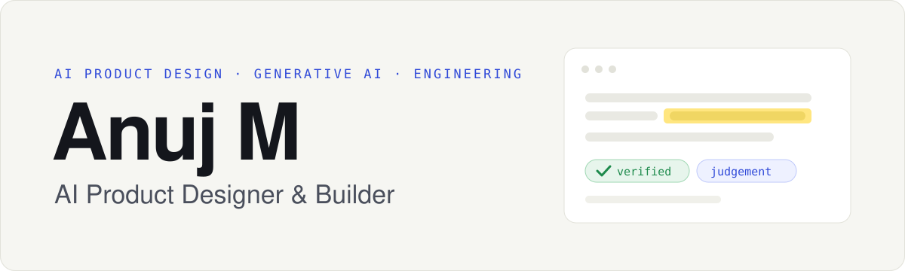
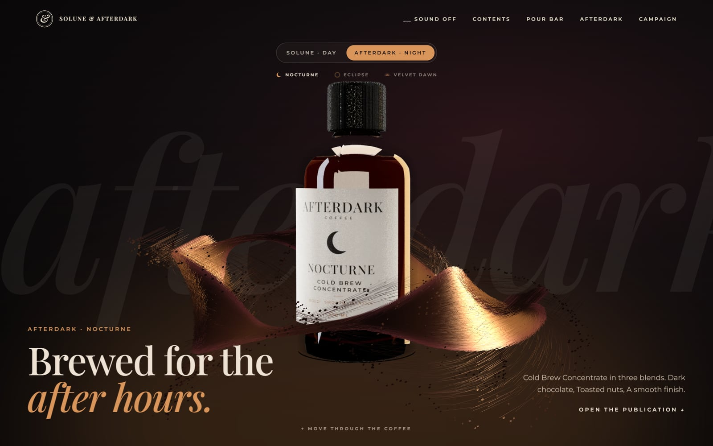

<picture>
  <source media="(prefers-color-scheme: dark)" srcset="assets/banner-dark.svg">
  
</picture>

### I design and build AI products that people can check, trust and actually use.

I take an AI product from a problem worth solving to a working, deployed experience: the user flow, the interface and the design system, the model and retrieval pipeline behind it, and the evaluations that show whether it works. My background is in **LLM evaluation** (a year reviewing model outputs for accuracy and safety at Keywords Studios) and **Computer Science with AI & ML**, so I design AI features around what models get wrong, not just what they get right.

---

## How I design AI products

These show up in every project below.

- **Show the evidence.** Every AI claim links to the passage it came from, and the quote is checked against the source before it's shown.
- **Separate fact from judgement.** Users can see what the document says and what the model inferred.
- **"I don't know" is a feature.** When the sources don't support an answer, the product says so instead of guessing.
- **AI drafts, people decide.** Nothing is sent, published or overwritten without a person choosing to.
- **Measure before claiming.** I build labelled test sets and report results, including the failures.

---

## Featured work

### Shortlist · AI resume assistant

**Problem.** Resume tools give a mysterious "ATS score" and rewrite bullets with numbers you never achieved. 
**Solution.** Shortlist judges a resume against a job ad requirement by requirement, quoting the resume as evidence for each verdict, and suggests rewrites that are checked for invented facts.

- Explainable readability checks instead of a made-up score; match reports with quoted evidence; a job-aware assistant; a side-by-side editor with undo/redo and Word export
- Hybrid retrieval (local embeddings + BM25) and structured LLM outputs; every quote is verified against the resume, and unsupported claims are flagged
- On a labelled, synthetic test set of 74 job requirements, requirement-matching accuracy went from **0.22 to 0.91**, with **no missing requirement marked as met**
- A marketing site, a workspace and a documented [design system](https://shortlist-resume-neon.vercel.app/design-system) built from the real components

`Python` `FastAPI` `Google Gemini` `RAG` `Next.js` `TypeScript` `Tailwind CSS` `SQLite` `Docker`

**[Live demo](https://shortlist-resume-neon.vercel.app)** · **[Case study](https://shortlist-resume-neon.vercel.app/case-study)** · **[Code](https://github.com/anuj1102001/AI-Resume-Assistant)**

Free hosting: the first visit can take up to a minute while the server wakes up.

### Margin · document assistant you can check

**Problem.** AI summaries of contracts and reports sound confident, but you can't tell which parts are true. 
**Solution.** Margin summarises, answers questions, extracts key facts and compares documents. Every claim carries a quote, verified against the page and highlighted on the original in one click.

- Page-aware chunking, hybrid retrieval and quote verification; each claim labelled *stated* or *interpretation*
- On 54 evaluation questions: **46/47 answers correct, 6/7 unanswerable questions correctly refused, 100% of cited quotes verified**
- Built for reading: a document outline, a source panel, light and dark themes, and a phone layout

`Python` `FastAPI` `Google Gemini` `PyMuPDF` `Embeddings` `Next.js` `TypeScript`

**[Live demo](https://margin-docs.vercel.app)** · **[Case study](https://margin-docs.vercel.app/case-study)** · **[Code](https://github.com/anuj1102001/AI-Document-Summarizer)**

### FITFLOW AI · product prototype for fitness influencers and creators

**Problem.** Fitness influencers and creators who coach their followers run the business from DMs and spreadsheets, so interested leads and slipping clients go quiet. 
**Solution.** An interactive SaaS prototype built around one loop: a *Today* queue says who to message and why, follow-up sequences pause when someone replies, and every AI draft explains its reasoning. The creator always presses send.

- Product definition and scope decisions, including cutting v1's storefront builder to focus on the follow-up loop
- Design system with light and dark themes, colour tokens mirrored as variables in a [Figma file](https://www.figma.com/design/tplM1llRbk13QxwC9bzAxU), and motion design with GSAP
- Nine working screens (Today, Sequences, Leads CRM, Compose, Bookings, Clients, Analytics, Assistant, AI Offer Builder) running on sample data

`Figma` `Next.js` `React` `TypeScript` `Tailwind CSS` `GSAP` `Zustand` `Recharts`

**[Live demo](https://fitflow-showcase.vercel.app)** · **[Case study](https://fitflow-showcase.vercel.app/case-study)** · **[Code](https://github.com/anuj1102001/fitflow-showcase)**

A portfolio prototype: a fictional fitness creator, sample data and simulated AI. No messages are ever sent.

### Creators Store · storefront for Indian creators in every niche

**Problem.** Influencers and creators in every niche who sell on Instagram (programs, courses, downloads, calls and services) take orders in DMs, check UPI screenshots by hand, and lose a cut of every sale to creator platforms. 
**Solution.** A store, UPI checkout and instant delivery in one bio link. Buyers pay straight into the creator's own Razorpay account, so the platform takes 0% commission and never holds the money.

- A guided payments setup: step-by-step Razorpay connection, keys checked with Razorpay and stored encrypted, and a test purchase before going live
- Store builder, products and private downloads, orders and refunds, customer list, analytics, and a "You kept" dashboard comparing 0% commission with a typical 10% platform
- Orders fulfilled only after server-side payment verification, with reconciliation for buyers who close the tab, and 33 automated tests covering payments, refunds and webhooks
- Light, dark and match-device themes; AI tools are kept in a clearly labelled preview until they run on a real model

`Next.js` `React` `TypeScript` `PostgreSQL` `Drizzle ORM` `Razorpay API` `Vercel`

**[Live site](https://www.creators-store.site)** · **[Walkthrough video](https://anuj1102001.github.io/creators-store-showcase/watch.html)** · **[Showcase](https://github.com/anuj1102001/creators-store-showcase)**

Live on its own domain and tested end to end in Razorpay test mode. Early stage, with no paying customers yet. The application source is private.

### COMET 2.0 · Mumbai in Motion

**Problem.** City-themed products tend to become souvenirs: every landmark at once, flattened into a collage. 
**Solution.** An original concept for a Mumbai sneaker collection, told through everyday life (local trains, the CSMT terminus, vintage postcards, street lettering) and carried consistently from the shoe to the box, the campaign and the website.

- Three editions on one silhouette, with poster-box packaging, a three-world campaign with ad formats, and a 20-second launch film in 16:9 and 9:16
- A 10-chapter, scroll-driven launch site that respects reduced-motion settings and is built to stay fast on ordinary phones
- Design decisions documented, including dropping a weak real-time 3D shoe for the approved renders
- A case study that labels each claim as desk research, hypothesis, proposal or built

`Concept & art direction` `Brand & packaging` `Motion design` `Next.js` `TypeScript`

**[Launch site](https://comet-mumbai.vercel.app)** · **[Case study](https://comet-mumbai.vercel.app/case-study)** · **[Code](https://github.com/anuj1102001/comet-2-mumbai-in-motion)**

A fictional label made for this portfolio case study, not affiliated with any real brand. Nothing has been manufactured or sold.

### Solune & Afterdark · coffee brand concept site

**Problem.** Brand concepts usually stop at a moodboard and flat mockups, so you never get a feel for the product itself. 
**Solution.** Two coffee concentrates, one for each half of the day, presented as an interactive publication: a liquid-coffee opening you can stir with the cursor, a pour bar that builds a serve in 3D, and photoreal bottles path-traced from the site's own 3D models.

- A liquid sculpture of about 120,000 grains written in raw WebGL2, with the bottle rising out of it; quality adapts to the device and rendering pauses when it is off screen
- Product shots path-traced in the browser: glass with real wall thickness, coffee as a volume that light passes through, and bottle cutouts made from a two-render matte; earlier real-time renders shown beside them
- An editorial "book" structure: chapters, a night dial that morphs crescent to eclipse to dawn, a 3D pour bar, and a sound layer synthesised in the browser (off by default)
- A measured performance pass on the previous version: total blocking time down from 5,435 ms to 537 ms (production build, desktop, on my machine)

`Concept & art direction` `WebGL2 / GLSL` `Three.js` `React Three Fiber` `Path tracing` `GSAP` `Next.js` `TypeScript`

**[Live site](https://solune-afterdark.vercel.app)**

A concept: the brands, bottles and labels are my own designs, and campaign imagery was made with AI image tools under my art direction. Not affiliated with any coffee company; nothing is for sale. The source is private.

---

## Toolkit

What I've shipped with, and where you can see it.

**AI & Generative AI** 
LLM application development · prompt design · structured outputs · RAG · embeddings and semantic search · hybrid retrieval · grounding and citation checks · LLM evaluation 
Shown in Shortlist and Margin, and a year of LLM evaluation at Keywords Studios

**Product & UX design** 
Problem framing and scoping · user flows · interactive prototyping · design systems and tokens · interaction and motion design · explainable-AI patterns · case studies · Figma 
Shown in FITFLOW, Shortlist, COMET 2.0 and Solune & Afterdark

**Engineering** 
Python · FastAPI · TypeScript · JavaScript · React · Next.js · Tailwind CSS · WebGL2 / GLSL · Three.js · Django · REST APIs · payment API integration 
Shown across all the projects above

**Data & infrastructure** 
SQL · SQLite · PostgreSQL · MySQL · Pandas · Power BI · Tableau · Git · GitHub Actions CI · Docker · Vercel · Render 
Shown in Shortlist, Margin, Creators Store and my analytics work

**Automation** 
Scripted evaluation pipelines · automated screenshot and narrated-walkthrough generation · scheduled payment reconciliation 
Shown in Shortlist, Margin, FITFLOW and Creators Store

**Used in earlier projects:** LangChain, FAISS, Llama 3 with Ollama, Streamlit (the first versions of Shortlist and Margin); TensorFlow and OpenCV (medicine strip recognition, 2023).

**Learning now:** AI agents and tool-calling workflows, workflow automation, and running user research and usability tests for my own products (so far, my case studies are built on desk research and clearly labelled hypotheses).

---

## Experience

- **Data Analyst**, Togle Labs · *Jul 2026 – present*: operational and revenue analytics, Power BI dashboards and software prototypes
- **Technical Research Associate, AI**, Keywords Studios · *Nov 2025 – Jul 2026*: evaluated high-volume LLM outputs for accuracy, factual consistency and safety; root-cause analysis of hallucinations and failure patterns
- **Research Associate, AI**, Keywords Studios · *Jul 2025 – Nov 2025*: prompt creation, response evaluation, data annotation and dataset quality
- **B.Tech, Computer Science and Engineering (AI & ML)**, Presidency University, Bengaluru · *2020 – 2024*
- **Publications:** *Exploring the Evolution of GenAI in Music Composition* (IJFMR, 2024) · *Medicine Strip Recognition using Deep Learning* (IJCRT, 2024)

---

## What I'm looking for

Roles where design, AI and engineering meet, and where I can own an AI feature from the first sketch to what ships:

**AI Product Designer** · **AI / UX Designer** · **AI Product Developer** · **Generative AI Engineer** · **AI Automation**

I'm most useful on teams building LLM-powered products where trust matters: assistants, document and knowledge tools, and workflows where AI does the busywork and people stay in control.

---

## How I work

I build with AI coding agents (mainly [Claude Code](https://claude.com/claude-code)). I choose the problem, set the product direction and the design, review the code and the evaluations, and decide what ships. Each project's README says how it was made. Ask me about any decision in these projects and I'll walk you through it.

Other work: [analytics portfolio](https://anuj1102001.github.io) · [BookYourShow](https://github.com/anuj1102001/BookYourShow) (Django ticket booking) · [Shoply](https://github.com/anuj1102001/SHOPLY-ECOMMERCE-SITE) (responsive storefront) · [Medicine strip recognition](https://github.com/anuj1102001/MEDICINE-STRIP-RECOGNITION) (deep learning, 2023)
